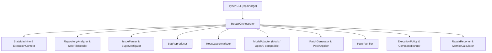
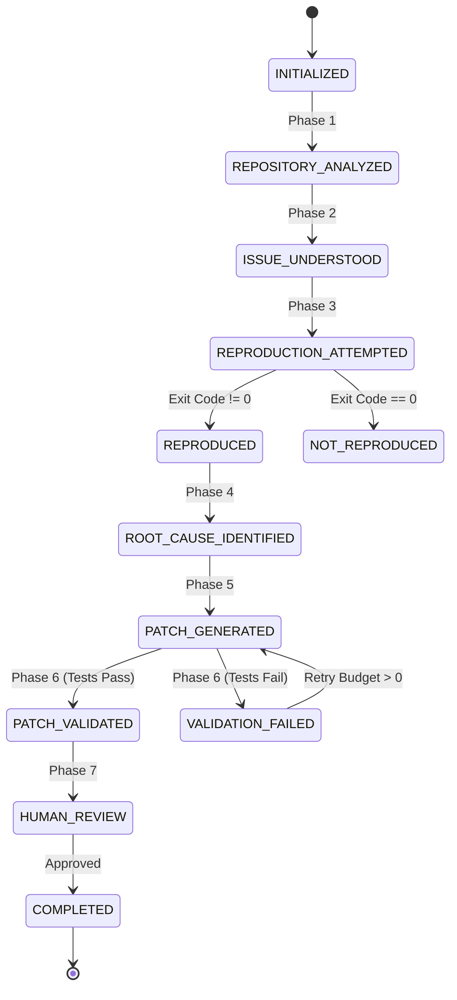

# RepairForge AI

> **Investigate. Reproduce. Repair. Verify.**

RepairForge AI is an open-weight, model-agnostic debugging and code-repair agent harness.

It systematically investigates software repositories, understands bug reports, reproduces failures, identifies root causes, generates minimal code patches, executes verification tests, and presents evidence for human approval.

---

## 1. Project Overview

RepairForge AI provides an evidence-driven, checkpoint-based execution harness for autonomous software repair. Unlike conventional code generators that propose unverified patches, RepairForge operates under a foundational principle:

> **A generated patch is not a successful repair until it has been verified with passing tests.**

The system prioritizes reproducibility, safety boundaries, model interchangeability, and transparent evaluation.

---

## 2. Problem Statement

Modern AI coding assistants often generate plausible-looking code suggestions that:
- Introduce subtle regressions into untouched modules.
- Guess at defect causes without inspecting execution traces or reproducing failures.
- Lack execution verification, forcing human engineers to manually test each recommendation.
- Rely on opaque, proprietary cloud models without support for self-hosted, open-weight alternatives.
- Run uncontained shell commands that risk host system security.

---

## 3. The RepairForge Solution

RepairForge AI transforms code repair into a verifiable scientific workflow:
1. **Repository-Aware Analysis**: Discovers structure, languages, dependency manifests, and test frameworks while ignoring caches and virtual environments.
2. **Defect Reproduction**: Executes test commands before proposing changes to confirm defect presence.
3. **Evidence-Grounded Root Cause Analysis**: Identifies exact defect locations using stack traces and AST context without hallucinating facts.
4. **Minimal Patch Generation**: Generates unified diffs restricted strictly to affected files.
5. **Rigorous Verification**: Runs Python AST syntax validation and regression test suites in an isolated temporary workspace.
6. **Explicit Human Gate**: Never automatically commits, merges, or pushes code. Requires human sign-off with clear evidence presented.

---

## 4. Core Features

- **Checkpoint-Based State Machine**: Enforces strict transitions from `INITIALIZED` to `COMPLETED`. Skipping checkpoints is prevented.
- **Model-Agnostic Abstraction**: Interchangeable adapters for deterministic mocks, OpenAI-compatible APIs (vLLM, Ollama, LocalAI, Hugging Face TGI), and open-weight models.
- **Sandboxed Execution Policy**: Command whitelisting, hard execution timeouts, and path-traversal prevention.
- **Standard Agent Skill (`bugrepro`)**: Full compliance with the open Agent Skills specification.
- **Structured Reporting**: Produces human-readable GitHub Flavored Markdown reports and machine-readable JSON evaluation logs.

---

## 5. Architecture

RepairForge is structured into decoupled components:



For comprehensive details on components, data flow, and interfaces, see [ARCHITECTURE.md](file:///c:/Users/arpit/Bugrepo/Engineers-by-Mistake/docs/ARCHITECTURE.md).

---

## 5.1. Forge Command Web Interface & Cloud Deployment

Forge Command is the dedicated full-stack developer workstation for RepairForge AI:
- **Frontend (Vercel Ready)**: React 18, Vite, Tailwind CSS, TanStack Query, and Lucide Icons with automatic SPA rewrites and CDN asset caching.
- **Backend (Railway Ready)**: FastAPI ASGI layer containerized with Python 3.11, dynamic `$PORT` binding, platform health check (`/api/health`), and automated Vercel CORS configuration.

Detailed guides:
- [Forge Command Web App Guide](docs/WEB_APP.md)
- [Railway & Vercel Deployment Guide](docs/DEPLOYMENT.md)

---

## 6. Workflow Lifecycle

Every repair adheres to a 7-phase checkpoint lifecycle:



---

## 7. Technology Stack

- **Runtime**: Python 3.10+ (tested through Python 3.14)
- **CLI Framework**: Typer & Rich
- **Data Modeling & Validation**: Pydantic v2
- **Testing**: pytest
- **HTTP / Inference Client**: httpx
- **Configuration & Metadata**: PyYAML

---

## 8. Model Abstraction Layer

RepairForge decouples high-level repair logic from specific LLM providers via `BaseModelAdapter`:

```python
from repairforge.models.base import BaseModelAdapter, Message, ModelResponse

class CustomModelAdapter(BaseModelAdapter):
    def generate(self, messages: list[Message], **kwargs) -> ModelResponse:
        ...
```

Included adapters:
- **`MockModelAdapter`**: A deterministic test fixture that generates predictable root-cause analyses and patches for unit testing and CI demonstration. Clearly labeled as a mock in logs.
- **`OpenAICompatibleModelAdapter`**: Compatible with any `/v1/chat/completions` endpoint (vLLM, Ollama, OpenAI, Hugging Face TGI). Credentials are loaded strictly from environment variables.

---

## 9. Agent Skill: BugRepro

RepairForge bundles a standard Agent Skill package located at [`skills/bugrepro`](file:///c:/Users/arpit/Bugrepo/Engineers-by-Mistake/skills/bugrepro):

- **`SKILL.md`**: Valid Agent Skills package with standard YAML frontmatter.
- **`references/workflow.md`**: In-depth guidance for each debugging phase.
- **`references/security.md`**: Threat containment, prompt injection defense, and execution bounds.
- **`references/report-format.md`**: Standard report schema specifications.
- **`scripts/validate_patch.py`**: AST and path validation helper.
- **`assets/bug_report_template.md`**: Standard defect specification template.

Validate the skill anytime using the CLI:
```bash
repairforge skill validate
```

---

## 10. Installation

Clone the repository and install in editable mode:

```bash
git clone https://github.com/arpitmishra6567/Engineers-by-Mistake.git
cd Engineers-by-Mistake

# Create virtual environment
python -m venv .venv

# Activate virtual environment
# Windows:
.venv\Scripts\activate
# Linux/macOS:
source .venv/bin/activate

# Install RepairForge and dependencies
pip install --upgrade pip
pip install -e ".[dev,openai]"
```

---

## 11. Quick Start

Run the deterministic bug-repair demonstration out of the box:

```bash
repairforge demo
```

Inspect any codebase repository:
```bash
repairforge inspect --repo .
```

---

## 12. CLI Usage

RepairForge provides a Typer CLI:

```bash
# Display help and available commands
repairforge --help

# Display installed version
repairforge version

# Inspect codebase structure and dependencies
repairforge inspect --repo /path/to/repo

# Validate the Agent Skill metadata
repairforge skill validate

# Run the end-to-end deterministic demonstration
repairforge demo

# Display the latest generated repair report
repairforge report --latest
```

---

## 13. Demonstration Walkthrough

RepairForge includes a deterministic defect fixture in [`examples/buggy_average`](file:///c:/Users/arpit/Bugrepo/Engineers-by-Mistake/examples/buggy_average):

```python
# average.py
def calculate_average(numbers):
    return sum(numbers) / len(numbers)
```

1. **The Issue**: When passed an empty list `[]`, `calculate_average` fails with `ZeroDivisionError` instead of raising an explicit `ValueError`.
2. **Reproduction**: The test suite `test_average.py` initially fails with exit code 1.
3. **Diagnosis**: Root cause identified as unguarded division when `len(numbers) == 0`.
4. **Patch**: Unified diff generated by `MockModelAdapter` adds `if not numbers: raise ValueError(...)`.
5. **Verification**: Patch applied in an isolated temporary clone; regression tests pass with exit code 0.
6. **Result**: Marked `VERIFIED` and report exported to `results/`. Original files remain unmodified.

---

## 14. Testing

Run the test suite with pytest:

```bash
python -m pytest -v
```

The 25 test cases verify:
- Model adapter generation and mock tagging.
- State transitions and prevention of invalid skips.
- Safe file reading and path traversal rejection.
- Ignored directories (`.git`, `.venv`, caches).
- Subprocess timeout enforcement.
- Agent Skill frontmatter compliance.
- End-to-end demonstration flow.

---

## 15. Kaggle Qwen Experiment

We provide instructions for evaluating open-weight models on Kaggle using `Qwen/Qwen2.5-Coder-1.5B-Instruct`.

See [`notebooks/README.md`](file:///c:/Users/arpit/Bugrepo/Engineers-by-Mistake/notebooks/README.md) for step-by-step setup, inference prompts, and reproducible test execution instructions.

---

## 16. Evaluation Metrics

RepairForge tracks factual execution metrics across tasks via `MetricsCalculator`:
- **Reproduction Rate**: `reproduced_tasks / total_tasks`
- **Repair Success Rate**: `verified_repairs / total_tasks`
- **Mean Execution Time**: Average seconds per repair lifecycle
- **Retry Count**: Iterations required before passing tests

Metrics are exported to `results/repair_report_<task_id>.json`.

---

## 17. Security Model

RepairForge enforces strict defense-in-depth:
- **Path Traversal Protection**: All paths resolved against workspace root.
- **Execution Policy**: Whitelists safe test commands (`pytest`, `unittest`).
- **Blocked Operations**: Forbids `rm -rf`, `git push`, `git commit`.
- **Subprocess Timeouts**: Prevents hang or infinite loop denial-of-service.
- **Credential Protection**: API keys loaded via environment variables, never logged.

Full details are documented in [docs/SECURITY.md](file:///c:/Users/arpit/Bugrepo/Engineers-by-Mistake/docs/SECURITY.md).

---

## 18. Limitations

- **Mock Adapter Scope**: The default local mock adapter uses deterministic rules designed for harness validation; it is not an LLM.
- **Host Execution Sandbox**: Host execution is restricted to safe test commands. For untrusted third-party code, use Docker container isolation.
- **Language Coverage**: Full AST syntax validation currently supports Python. Other languages rely on test suite exit codes.

---

## 19. Roadmap

- [ ] **Docker Execution Backend**: OCI containerization for untrusted repositories.
- [ ] **Multi-language AST Parsing**: Tree-sitter integration for TypeScript, Go, and Rust syntax validation.
- [ ] **Benchmark Harness**: Automated evaluation runner for SWE-bench Lite.
- [ ] **GitHub Pull Request Integration**: Automated bot to draft PRs with attached verification evidence.
- [x] **Web Inspection Dashboard**: Forge Command React + Vite dark IDE interface.
- [x] **Cloud Deployment**: Vercel SPA deployment + Railway containerized backend.

---

## 20. Contribution Guidelines

Contributions are warmly welcomed! Please review:
- [CONTRIBUTING.md](file:///c:/Users/arpit/Bugrepo/Engineers-by-Mistake/CONTRIBUTING.md) for contribution guidelines.
- [DEVELOPMENT.md](file:///c:/Users/arpit/Bugrepo/Engineers-by-Mistake/docs/DEVELOPMENT.md) for local development setup.

---

## 21. License

This project is licensed under the MIT License — see the [LICENSE.md](file:///c:/Users/arpit/Bugrepo/Engineers-by-Mistake/LICENSE.md) file for details.
