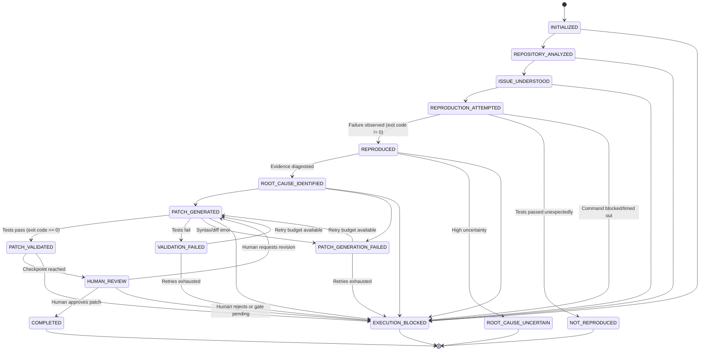
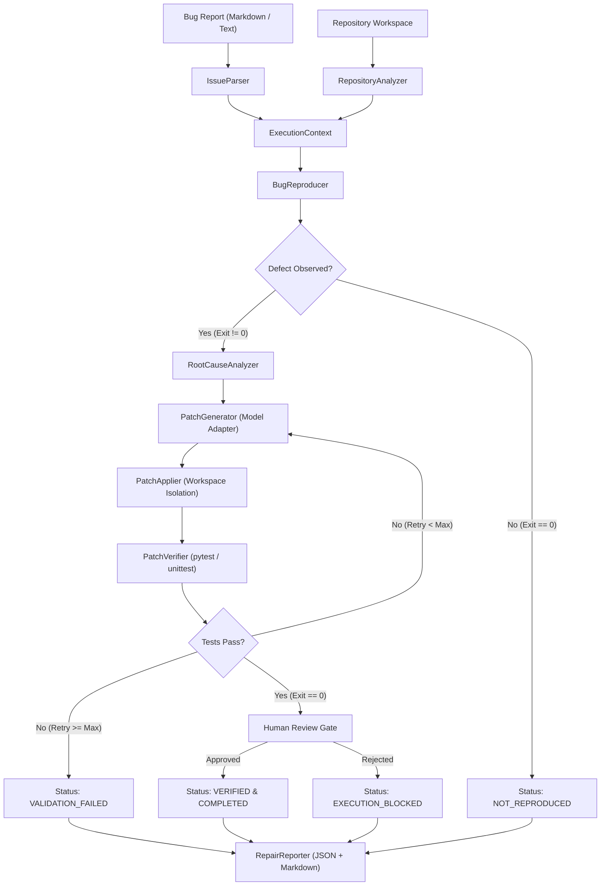

# RepairForge AI Architecture

RepairForge AI is an open-weight, model-agnostic debugging and code-repair agent harness built on the principle that:
> **A generated patch is not a successful repair until it has been verified with passing tests.**

---

## 1. System Components

RepairForge is architected into decoupled, single-responsibility modules:

```
repairforge/
├── agent/            # State machine, execution context, and orchestrator
├── models/           # Interchangeable LLM adapters (Mock, OpenAI-compatible)
├── repository/       # Safe repository inspection, AST parsing, and code search
├── investigation/    # Issue parsing, test reproduction, and root-cause analysis
├── repair/           # Unified diff generation, safe patch application, and verification
├── execution/        # Sandbox policies, command runner, and timeout enforcement
└── evaluation/       # Metrics calculation and report generators
```

### Component Summary

| Component | Responsibility |
| :--- | :--- |
| **`RepairOrchestrator`** | Coordinates the 7-phase repair lifecycle, enforces checkpoints, manages retries, and requests human approval. |
| **`StateMachine`** | Validates legal transitions across execution states; prevents skipping checkpoints. |
| **`ExecutionContext`** | Holds the complete mutable state of a repair task, tracking reproduction evidence, root cause records, diffs, and test results. |
| **`BaseModelAdapter`** | Abstract interface decoupling high-level reasoning from model providers (Mock, OpenAI, vLLM, Ollama, Hugging Face). |
| **`RepositoryAnalyzer`** | Read-only scanner extracting file lists, language distribution, dependency configs, and test runners while ignoring `.git`, `.venv`, and caches. |
| **`SafeFileReader`** | Prevents path traversal (`../../`) and enforces max-file-size constraints (1MB default). |
| **`BugReproducer`** | Executes reproduction commands, capturing stdout, stderr, exit code, and execution duration without fabricating results. |
| **`RootCauseAnalyzer`** | Synthesizes failure stack traces and code context to diagnose defects with explicit confidence levels (`LOW`, `MEDIUM`, `HIGH`). |
| **`PatchGenerator`** | Generates minimal unified diffs constrained strictly to target files within the repository boundary. |
| **`PatchApplier`** | Applies unified diffs in memory/disk with atomic rollback capabilities. |
| **`PatchVerifier`** | Runs Python AST syntax verification and regression tests; marks repairs `VERIFIED` only if tests exit with code 0. |
| **`CommandRunner`** | Executes shell commands under strict timeouts, capturing output and blocking destructive operations. |
| **`RepairReporter`** | Generates standard Markdown reports and structured JSON exports. |

---

## 2. Execution State Machine

RepairForge enforces a checkpoint-based state machine. Transitions are validated against an explicit transition map (`VALID_TRANSITIONS`).



---

## 3. Data Flow Diagram



---

## 4. Extension Points

1. **Model Providers**: Implement `BaseModelAdapter` to connect proprietary or open-weight inference backends (e.g. Anthropic, Gemini, Mistral, Ollama, Hugging Face TGI).
2. **Containerized Sandboxing**: Extend `CommandRunner` with Docker or Firecracker microVM backends for untrusted repositories.
3. **Multi-language Support**: Add language syntax parsers in `PatchVerifier` for TypeScript, Go, Rust, or Java.

