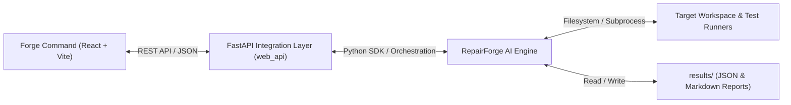

# Forge Command — Web Application Documentation

**Forge Command** is the production-minded developer workstation and web interface for **RepairForge AI**.

It enables software teams and reliability engineers to monitor autonomous code repairs, review candidate diffs, inspect test reproduction and regression evidence, and run offline model benchmark evaluations.

---

## 1. Architecture Overview

Forge Command combines a reactive TypeScript/React frontend with the existing Python `RepairForge` engine via a FastAPI integration layer.



- **Frontend (`frontend/`)**: React 18, TypeScript, Vite, Tailwind CSS, TanStack Query, Lucide React, and React Router.
- **Backend API (`web_api/`)**: FastAPI, Pydantic, Starlette, Uvicorn, and `RepairOrchestrator`.

---

## 2. Prerequisites

- Python 3.10+ (with virtual environment)
- Node.js 18+ and npm 9+
- Git

---

## 3. Quick Start & Startup Commands

### Step 1: Set Up Backend Virtual Environment
```bash
# In the repository root:
python -m venv .venv

# Activate virtual environment
# Windows (PowerShell):
.\.venv\Scripts\activate
# Linux / macOS:
source .venv/bin/activate

# Install RepairForge and Web API dependencies
pip install -e ".[dev,openai]"
pip install fastapi uvicorn
```

### Step 2: Start the FastAPI Backend Server
```bash
python -m uvicorn web_api.main:app --reload --host 127.0.0.1 --port 8000
```
The API documentation and Swagger UI will be available at:
`http://127.0.0.1:8000/docs`

### Step 3: Run the Frontend

#### Option A: Development Mode (Vite with hot-reload & API proxy)
```bash
cd frontend
npm install
npm run dev
```
Open your browser at `http://localhost:5173`. Requests to `/api/*` are automatically proxied to the backend at `http://127.0.0.1:8000`.

#### Option B: Standalone Production Build
The frontend can be compiled into static assets:
```bash
cd frontend
npm run build
```
Once built into `frontend/dist`, the FastAPI server serves the full React application directly at:
`http://127.0.0.1:8000/`

#### Option C: Cloud Deployment (Vercel + Railway)
For instructions on deploying the frontend to **Vercel** and the backend to **Railway**, refer to [docs/DEPLOYMENT.md](DEPLOYMENT.md).
- **Backend on Railway**: Powered by root `Dockerfile`, `railway.toml`, and dynamic `$PORT` binding.
- **Frontend on Vercel**: Powered by `vercel.json` SPA rewrites and environment-driven `VITE_API_URL`.

---

## 4. API Endpoints Reference

| Method | Endpoint | Description |
| :--- | :--- | :--- |
| `GET` | `/api/health` | Service health status and version. |
| `GET` | `/api/dashboard/summary` | Real-time aggregated statistics from execution runs. |
| `GET` | `/api/repairs` | List all historical and active repair runs. |
| `POST` | `/api/repairs` | Initialize an asynchronous repair workflow. |
| `GET` | `/api/repairs/{task_id}` | Detailed execution context and checkpoint history. |
| `GET` | `/api/repairs/{task_id}/logs` | Timestamped live execution logs. |
| `GET` | `/api/repairs/{task_id}/report`| Raw Markdown repair report. |
| `GET` | `/api/evaluations` | List Kaggle and local benchmark evaluations. |
| `GET` | `/api/evaluations/{id}` | Specific evaluation record and test comparison. |
| `GET` | `/api/repositories/known` | Accessible repository fixtures. |
| `GET` | `/api/repositories/inspect` | Detailed file, language, and test inspection. |
| `GET` | `/api/models` | Configured model adapters and endpoints. |
| `GET` | `/api/skills` | BugRepro Agent Skill metadata. |
| `POST` | `/api/skills/validate` | Live validation against Agent Skills spec. |

---

## 5. Running Automated Tests

### Backend Test Suite (pytest)
```bash
python -m pytest -v
```
Runs 32 unit, integration, and API tests validating state transitions, safe file readers, orchestrator lifecycles, and FastAPI routes.

### Frontend Test Suite (Vitest)
```bash
cd frontend
npm run test
```

### TypeScript Validation & Production Build
```bash
cd frontend
npm run build
```

---

## 6. Security Boundaries & Known Limitations

1. **Local Host Execution**: Local test execution runs in `SAFE_FIXTURE` mode with strict command whitelisting (`pytest`, `unittest`) and 60-second timeouts. Docker container isolation is recommended before running untrusted third-party repositories.
2. **Path Containment**: The server validates all repository paths to ensure they stay within permitted server workspace roots. Path traversal attacks (`../../`) are blocked.
3. **No Unauthenticated Remote Push**: Human approval is an explicit gate. RepairForge never automatically pushes, merges, or publishes code changes to remote repositories.

